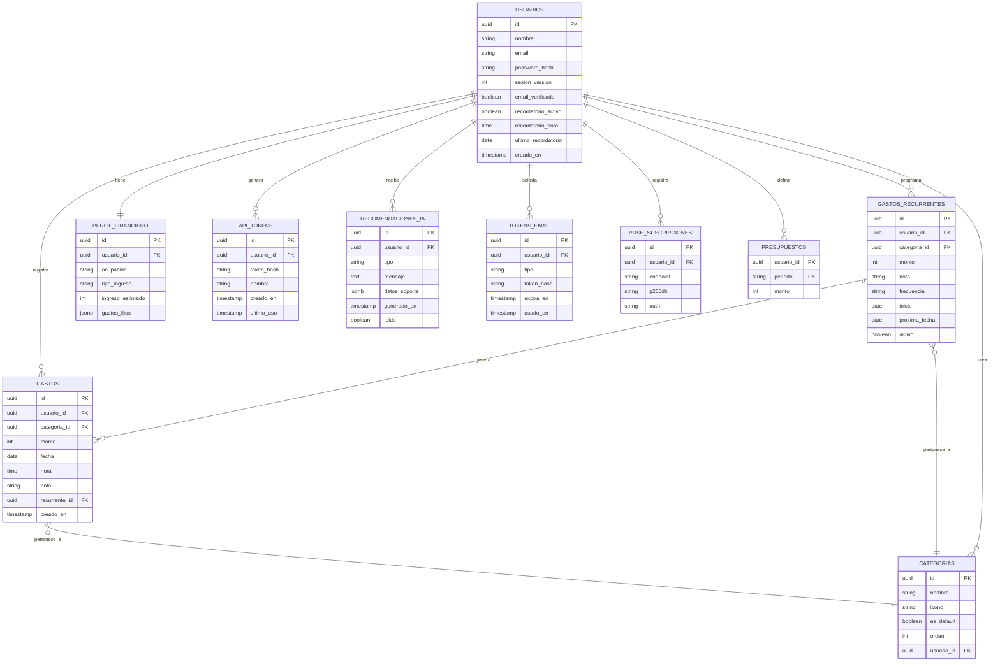

# PesoXPeso — Modelo de Datos

## Diagrama entidad-relación

## Notas de diseño

- **usuarios**: autenticación básica en MVP (email/password). Se puede migrar a OAuth después sin tocar el resto del modelo.
- **usuarios.sesion_version**: cada refresh token lleva la versión vigente al firmarse. Cambiar la contraseña o cerrar sesiones la incrementa, y con eso quedan revocados todos los refresh anteriores sin necesidad de una tabla de sesiones.
- **Borrado de cuenta**: `api_tokens`, `perfil_financiero` y `gastos` referencian a `usuarios` con `ON DELETE CASCADE`, así que borrar el usuario elimina todos sus datos.
- **api_tokens**: tokens personales de larga duración (guardados como hash) pensados para el Atajo de iPhone, que no puede renovar un JWT corto. Se pueden revocar desde la app sin cerrar sesión.
- **perfil_financiero**: relación 1 a 1 con usuario. `gastos_fijos` como JSONB para no crear una tabla aparte en el MVP (ej: `{"arriendo": 400000, "servicios": 80000}`). `ocupacion` y `tipo_ingreso` tienen `CHECK` en la base con los mismos valores que valida la API.
- **categorias**: `usuario_id` nulo = categoría por defecto, visible para todos (snacks y bebidas, domicilio, transporte, propina, otro); con valor = categoría propia de ese usuario. El nombre es único entre las de por defecto y, aparte, dentro de las de cada usuario. Al borrar una propia, sus gastos pasan a *Otro*. **Ojo:** como `categorias` referencia a `usuarios`, un `TRUNCATE usuarios CASCADE` vaciaría también las de por defecto; para limpiar se usa `DELETE FROM usuarios`.
- **tokens_email**: enlaces de un solo uso para verificar el correo (48 h) y recuperar la contraseña (1 h). Solo se guarda el hash; pedir uno nuevo invalida el anterior del mismo tipo.
- **push_suscripciones**: una fila por navegador que aceptó notificaciones. `usuarios.ultimo_recordatorio` evita avisar dos veces el mismo día.
- **presupuestos**: como máximo uno semanal y uno mensual por usuario (clave primaria compuesta).
- **gastos_recurrentes**: `inicio` fija el día de la semana o del mes y `proxima_fecha` es la siguiente vez que toca. Los gastos que generan llevan `gastos.recurrente_id` (queda en `NULL` si se borra el recurrente) y no cuentan para la racha.
- **monto (gastos) e ingreso_estimado**: enteros en pesos colombianos. COP no se usa con decimales en el día a día, y así se evitan errores de redondeo y strings numéricos en el driver.
- **gastos**: la tabla central. Índice compuesto en `(usuario_id, fecha)` porque la consulta más frecuente es "gastos de este usuario en este día/rango".
- **recomendaciones_ia**: aún no existe en la base; se crea en la Fase 5 (IA). `datos_soporte` guarda el JSON con los números que sustentan la recomendación (para poder mostrar el gráfico de detalle sin recalcular).

## Consultas frecuentes a optimizar
- Gastos por usuario y rango de fechas (vista calendario) → índice `(usuario_id, fecha)`.
- Suma de gastos por categoría en un rango (gráficos) → índice `(usuario_id, categoria_id, fecha)` o agregación en el backend con cache corto.
