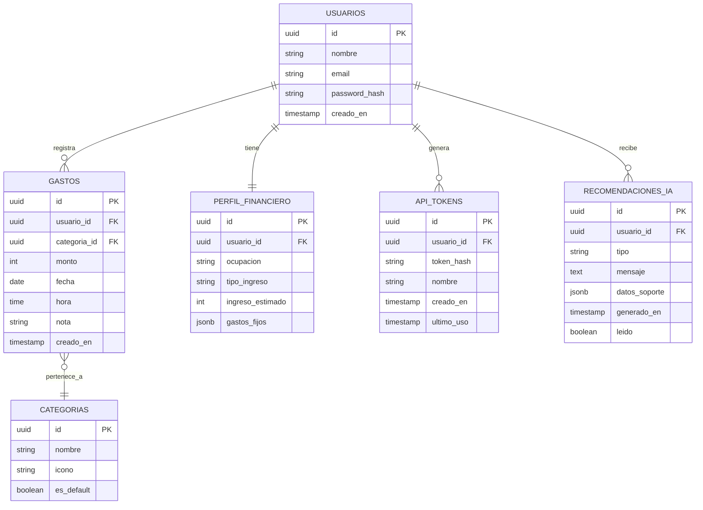

# PesoXPeso — Modelo de Datos

## Diagrama entidad-relación

## Notas de diseño

- **usuarios**: autenticación básica en MVP (email/password). Se puede migrar a OAuth después sin tocar el resto del modelo.
- **api_tokens**: tokens personales de larga duración (guardados como hash) pensados para el Atajo de iPhone, que no puede renovar un JWT corto. Se pueden revocar desde la app sin cerrar sesión.
- **perfil_financiero**: relación 1 a 1 con usuario. `gastos_fijos` como JSONB para no crear una tabla aparte en el MVP (ej: `{"arriendo": 400000, "servicios": 80000}`).
- **categorias**: tabla separada (no enum) para poder agregar categorías personalizadas por usuario en el futuro sin migración de esquema. `es_default` marca las 5 categorías iniciales (snacks y bebidas, domicilio, transporte, propina, otro).
- **monto (gastos) e ingreso_estimado**: enteros en pesos colombianos. COP no se usa con decimales en el día a día, y así se evitan errores de redondeo y strings numéricos en el driver.
- **gastos**: la tabla central. Índice compuesto en `(usuario_id, fecha)` porque la consulta más frecuente es "gastos de este usuario en este día/rango".
- **recomendaciones_ia**: solo se usa en Fase 2. `datos_soporte` guarda el JSON con los números que sustentan la recomendación (para poder mostrar el gráfico de detalle sin recalcular).

## Consultas frecuentes a optimizar
- Gastos por usuario y rango de fechas (vista calendario) → índice `(usuario_id, fecha)`.
- Suma de gastos por categoría en un rango (gráficos) → índice `(usuario_id, categoria_id, fecha)` o agregación en el backend con cache corto.
